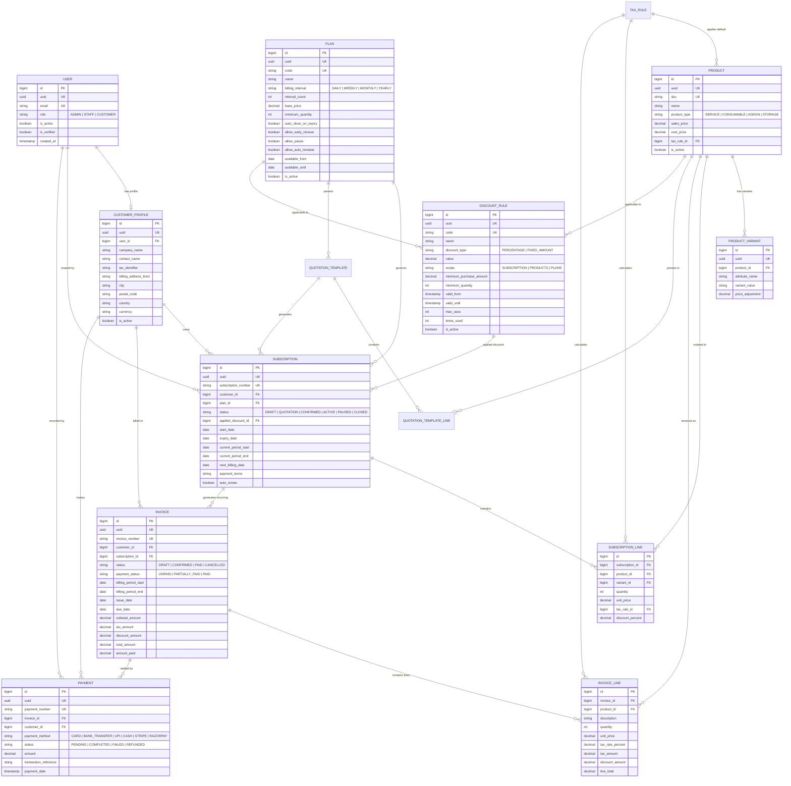

# Database Design & Schema Specification — SaasDeck

> **Author**: Manav (Database & Schema Lead)  
> **Target Database Engine**: PostgreSQL 16+  
> **Backend Framework**: Django 5 + Django REST Framework  
> **Status**: Ready for Backend Review (Nijoy) & Acceptance Testing Review (Albin)

---

## 1. Core Design Principles

1. **Idempotent Recurring Billing**:
   - Recurring invoice runs must never generate duplicate bills or double-charge a customer for the same billing window.
   - Enforced by database-level constraints: `UniqueConstraint(fields=['subscription', 'billing_period_start', 'billing_period_end'])`.
2. **Monetary & Pricing Snapshotting**:
   - Invoices and invoice lines preserve exact copies of the unit price, tax rate, and applied discount at the moment of billing.
   - Subsequent price alterations in the product catalog or plan tiers never alter past invoices or historical audit records.
3. **Auditable Referential Integrity**:
   - Crucial business entities (`CustomerProfile`, `Subscription`, `Invoice`, `Payment`, `Product`) employ `on_delete=models.PROTECT`. Historical accounting data cannot be inadvertently cascaded or deleted.
4. **Index Locality & Fast Reads (< 2s at Scale)**:
   - Composite B-tree indexes target high-frequency filter paths (e.g., customer portal lookups, overdue invoices, and Celery billing worker queries).
   - High-throughput surrogate integer keys (`BigAutoField`) maintain compact index trees, paired with public UUIDs (`PublicUUIDModel`) for external API routing.

---

## 2. Entity-Relationship (ER) Diagram



---

## 3. Schema & Model Breakdown

### 3.1. `accounts` App (`backend/apps/accounts/models.py`)
- **`User`**:
  - `email`: `EmailField(unique=True, db_index=True)`
  - `role`: `CharField(choices=['ADMIN', 'STAFF', 'CUSTOMER'], default='CUSTOMER', db_index=True)`
  - `phone_number`: `CharField(max_length=30, blank=True, null=True)`
  - `is_verified`: `BooleanField(default=False)`
  - **Index**: `['email', 'role']`

### 3.2. `customers` App (`backend/apps/customers/models.py`)
- **`CustomerProfile`**:
  - `user`: `OneToOneField(User, on_delete=models.CASCADE, related_name='customer_profile')`
  - `company_name`: `CharField(max_length=255, db_index=True)`
  - `contact_name`: `CharField(max_length=255)`
  - `tax_identifier`: `CharField(max_length=50, blank=True, null=True)` (e.g. GSTIN / VAT)
  - `billing_address_line1`, `city`, `state_province`, `postal_code`, `country`, `currency`
  - **Indexes**: `['company_name']`, `['is_active', 'country']`

### 3.3. `catalog` App (`backend/apps/catalog/models.py`)
- **`TaxRule`**:
  - `name`, `rate_percent`, `is_inclusive`, `is_active`, `is_default`
  - **Constraint**: `rate_percent >= 0.00 AND rate_percent <= 100.00`
- **`Product`**:
  - `name`, `sku` (unique), `product_type`, `sales_price`, `cost_price`, `tax_rule` (FK)
  - **Constraints**: `sales_price >= 0.00`, `cost_price >= 0.00`
  - **Indexes**: `['name', 'is_active']`, `['product_type', 'is_active']`
- **`ProductVariant`**:
  - `product` (FK), `attribute_name`, `variant_value`, `price_adjustment`
  - **Constraint**: `UniqueConstraint(['product', 'attribute_name', 'variant_value'])`

### 3.4. `plans` App (`backend/apps/plans/models.py`)
- **`Plan`**:
  - `name`, `code` (slug, unique), `billing_interval` (`DAILY`, `WEEKLY`, `MONTHLY`, `YEARLY`)
  - `interval_count`, `base_price`, `minimum_quantity`, `trial_period_days`
  - Policy flags: `auto_close_on_expiry`, `allow_early_closure`, `allow_pause`, `allow_auto_renewal`
  - Availability window: `available_from`, `available_until`
  - **Constraints**: `base_price >= 0`, `interval_count >= 1`, `minimum_quantity >= 1`, `available_until >= available_from`
  - **Index**: `['billing_interval', 'is_active']`

### 3.5. `discounts` App (`backend/apps/discounts/models.py`)
- **`DiscountRule`**:
  - `code` (unique), `name`, `discount_type` (`PERCENTAGE`, `FIXED_AMOUNT`), `value`
  - `scope` (`SUBSCRIPTION`, `PRODUCTS`, `PLANS`)
  - `minimum_purchase_amount`, `minimum_quantity`, `valid_from`, `valid_until`
  - `max_uses`, `times_used`, `is_active`
  - M2M: `applicable_products`, `applicable_plans`
  - **Constraints**: `value > 0`, `percentage <= 100`, `valid_until >= valid_from`
  - **Indexes**: `['code', 'is_active']`, `['valid_from', 'valid_until']`

### 3.6. `subscriptions` App (`backend/apps/subscriptions/models.py`)
- **`QuotationTemplate`** & **`QuotationTemplateLine`**: Predefined bundles for one-click quotations.
- **`Subscription`**:
  - `subscription_number`: Unique business key (e.g., `SUB-2026-0001`)
  - `customer` (FK `models.PROTECT`), `plan` (FK `models.PROTECT`), `applied_discount` (FK)
  - `status`: `DRAFT`, `QUOTATION`, `CONFIRMED`, `ACTIVE`, `PAUSED`, `CLOSED`
  - `start_date`, `expiry_date`, `current_period_start`, `current_period_end`, `next_billing_date`
  - `payment_terms`, `auto_renew`, `cancellation_reason`
  - **Constraints**: `expiry_date >= start_date`
  - **Indexes**: `['customer', 'status']`, `['status', 'next_billing_date']`, `['current_period_end']`
- **`SubscriptionLine`**:
  - `subscription` (FK `CASCADE`), `product` (FK `PROTECT`), `variant` (FK `PROTECT`)
  - `quantity`, `unit_price`, `tax_rule` (FK `PROTECT`), `discount_percent`

### 3.7. `billing` App (`backend/apps/billing/models.py`)
- **`Invoice`**:
  - `invoice_number`: Unique sequential invoice code (e.g., `INV-2026-00001`)
  - `customer` (FK `PROTECT`), `subscription` (FK `PROTECT`, optional)
  - `status`: `DRAFT`, `CONFIRMED`, `PAID`, `CANCELLED`
  - `payment_status`: `UNPAID`, `PARTIALLY_PAID`, `PAID`
  - `billing_period_start`, `billing_period_end`, `issue_date`, `due_date`, `paid_at`
  - Snapshots: `subtotal_amount`, `tax_amount`, `discount_amount`, `total_amount`, `amount_paid`
  - **Idempotency Constraint**:
    ```python
    UniqueConstraint(
        fields=['subscription', 'billing_period_start', 'billing_period_end'],
        condition=Q(subscription__isnull=False) & ~Q(status='CANCELLED'),
        name='unique_active_subscription_billing_period'
    )
    ```
  - **Constraints**: `due_date >= issue_date`, `total_amount >= 0`, `amount_paid >= 0`
  - **Indexes**: `['customer', 'status']`, `['status', 'due_date']`, `['payment_status', 'due_date']`
- **`InvoiceLine`**:
  - `invoice` (FK `CASCADE`), `product` (FK `PROTECT`, optional)
  - Historical snapshot fields: `description`, `quantity`, `unit_price`, `tax_rate_percent`, `tax_amount`, `discount_amount`, `line_total`

### 3.8. `payments` App (`backend/apps/payments/models.py`)
- **`Payment`**:
  - `payment_number`: Unique reference (e.g., `PAY-2026-00001`)
  - `invoice` (FK `PROTECT`), `customer` (FK `PROTECT`)
  - `payment_method`: `CREDIT_CARD`, `BANK_TRANSFER`, `UPI`, `CASH`, `STRIPE`, `RAZORPAY`
  - `status`: `PENDING`, `COMPLETED`, `FAILED`, `REFUNDED`
  - `amount`, `currency`, `transaction_reference`, `payment_date`
  - **Constraints**: `amount > 0`
  - **Indexes**: `['invoice', 'status']`, `['customer', 'status']`, `['payment_date', 'status']`

---

## 4. Integration Guide for Nijoy (Backend Lead)

In `settings.py`:

```python
# 1. Custom User Model
AUTH_USER_MODEL = "accounts.User"

# 2. Installed Apps
INSTALLED_APPS = [
    # Django core apps ...
    "rest_framework",
    "apps.core",
    "apps.accounts",
    "apps.customers",
    "apps.catalog",
    "apps.plans",
    "apps.discounts",
    "apps.subscriptions",
    "apps.billing",
    "apps.payments",
]

# 3. Database (PostgreSQL recommended)
DATABASES = {
    "default": {
        "ENGINE": "django.db.backends.postgresql",
        "NAME": os.environ.get("POSTGRES_DB", "saasdeck_db"),
        "USER": os.environ.get("POSTGRES_USER", "postgres"),
        "PASSWORD": os.environ.get("POSTGRES_PASSWORD", "postgres"),
        "HOST": os.environ.get("POSTGRES_HOST", "localhost"),
        "PORT": os.environ.get("POSTGRES_PORT", "5432"),
    }
}
```
